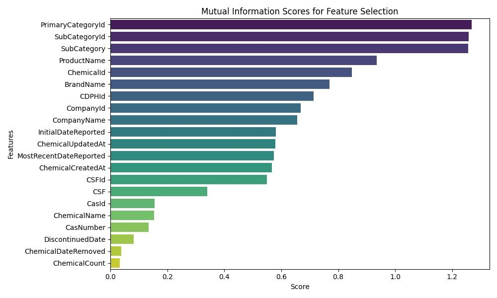
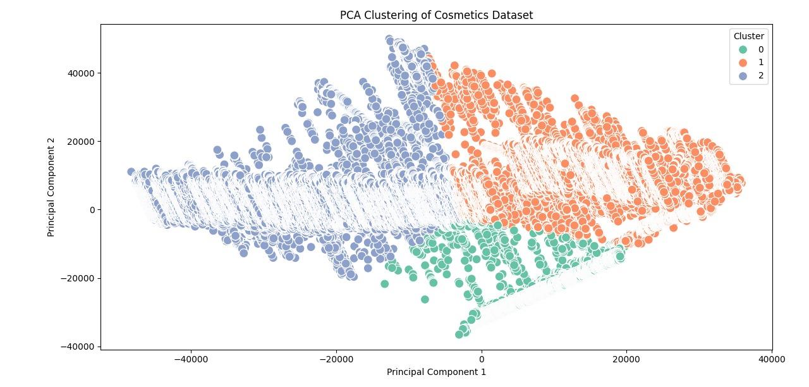
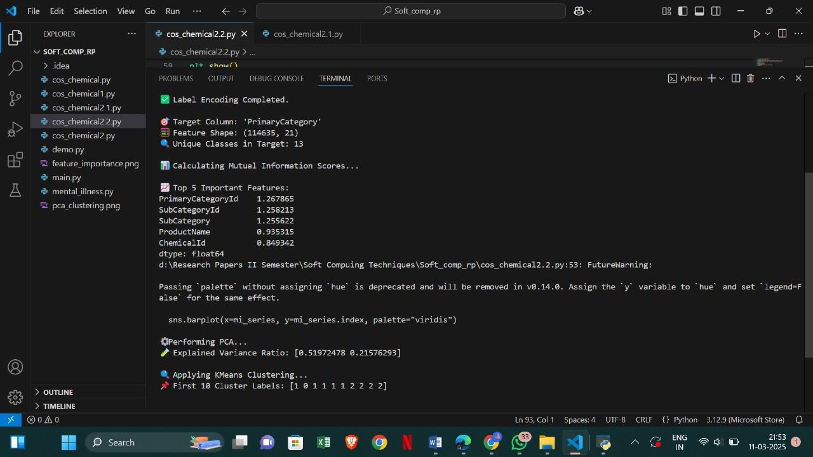

# Enhanced Feature Selection and Dimensionality Reduction with Clustering for Cosmetics Healthcare Data Analysis

A Python pipeline that ranks features with **mutual information**, reduces dimensions with **PCA**, and groups products with **KMeans** clustering on a cosmetics chemical dataset.

<p>
  
  
  
  
</p>

## 📖 Overview

Cosmetics data often has many columns that are redundant or only weakly related to the outcome of interest. This project applies three standard techniques in sequence:

1. **Feature selection:** mutual information scores show which columns carry the most information about the product category.
2. **Dimensionality reduction:** PCA projects the encoded data onto two principal components.
3. **Clustering:** KMeans groups the products in the PCA space, and the clusters are plotted.

## 🗂️ Dataset

| Item | Value |
|---|---|
| Source | [Add dataset source and link] |
| Rows after cleaning | 114,635 |
| Features | 21 |
| Target column | `PrimaryCategory` (13 classes) |

**Preprocessing:** rows missing `ProductName`, `PrimaryCategory` or `ChemicalCount` are dropped, other missing values are set to `Unknown`, and every column is label-encoded.

## ⚙️ Pipeline

| Step | Method | Setting |
|---|---|---|
| Encoding | `LabelEncoder` | All columns |
| Feature ranking | `mutual_info_classif` | Target: `PrimaryCategory` |
| Dimensionality reduction | PCA | 2 components |
| Clustering | KMeans | 3 clusters, `random_state=42` |

## 📊 Results

### Feature importance (mutual information)

| Rank | Feature | MI score |
|---|---|---|
| 1 | PrimaryCategoryId | 1.268 |
| 2 | SubCategoryId | 1.258 |
| 3 | SubCategory | 1.256 |
| 4 | ProductName | 0.935 |
| 5 | ChemicalId | 0.849 |

`ChemicalCount` and `ChemicalDateRemoved` scored lowest.



### PCA and clustering

The two principal components explain **51.97%** and **21.58%** of the variance, **73.55%** together.

KMeans with 3 clusters separates the projected data into three groups.



### Console output



## ⚠️ Limitations and Next Steps

- **Target-related columns rank highest.** `PrimaryCategoryId`, `SubCategoryId` and `SubCategory` are closely tied to the target `PrimaryCategory`, so their high scores are expected. Excluding them would give a more informative ranking.
- **No feature scaling before PCA.** The columns are label-encoded IDs and dates on very different scales, which is why the PCA axes run to about ±40,000. Standardising the data first would change the components.
- **Label encoding creates an artificial order** in categorical columns. One-hot or target encoding may suit some of them better.
- **The number of clusters (3) is fixed.** Check it with the elbow method or a silhouette score.
- **No predictive evaluation yet.** Adding a classifier (for example SVM) with accuracy and a confusion matrix would show how useful the selected features are.

## 🚀 How to Run

```bash
git clone https://github.com/Ramyaanbazhagan/Cosmetics-Feature-Selection-PCA-KMeans.git
cd Cosmetics-Feature-Selection-PCA-KMeans
pip install -r requirements.txt
```

Place the dataset CSV in the same folder (or change `DATA_PATH` in the script), then run:

```bash
python cosmetics_analysis.py
```

The script saves `feature_importance.png` and `pca_clustering.png`.

## 📁 Repository Structure

```
Cosmetics-Feature-Selection-PCA-KMeans/
├── cosmetics_analysis.py
├── requirements.txt
├── README.md
└── images/
```
[LinkedIn](https://linkedin.com/in/ramya-anbu) · [Portfolio](https://ramyaanbazhagan.github.io/portfolio/)
